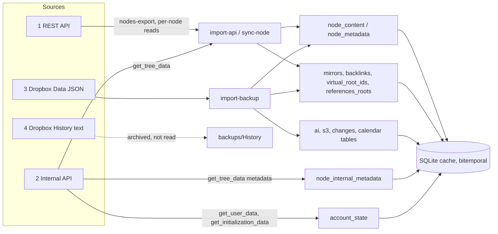

# Workflowy data sources: why this project merges four of them

Status: describes the code at the time of writing. Every claim cites a file or a test. Anything inferred rather than read from code is marked UNVERIFIED.

## Why this project exists

Workflowy holds more data on its server than any single way of reading it returns. The product has no export that is both complete and machine-friendly. So this project reads from several access paths, merges them into one local SQLite database, and keeps that database useful as a read model for the CLI, the MCP server, the local web app and the Cloudflare Durable Object.

The consequences shape the whole codebase.

- No source is complete, so no importer may treat its own absence-of-data as deletion of data it cannot see. This is the lesson behind most of the importer guards described below.
- Each field has a "best source". The importers are field-routed: each one writes only the tables it can speak for.
- Reads are served from SQLite. Writes go to Workflowy first and are mirrored into the cache afterwards. The rule in `CLAUDE.local.md` is that SQLite is a write-through cache and is never mutated directly.
- The standalone and Cloudflare work ("break-away") needs the union of all sources captured locally, because after break-away nothing can re-fetch what the cache lacks. See `.llm/plans/2026-10-25-standalone-dual-write.md`.

## The four sources

The set is not the one a casual reading suggests. The three obvious sources are the public REST API, the internal web-app API and the Dropbox JSON backup. The fourth is a second file in the same Dropbox app folder: the Dropbox "History" plain-text export. It is downloaded and archived, but no importer reads it.

| # | Source | Entry point in code | Auth | Imported into the cache |
| --- | --- | --- | --- | --- |
| 1 | Public REST API (`/api/v1/*`) | `packages/shared/src/api/workflowy-client.ts` | Bearer API key (`WORKFLOWY_API_KEY`) | Yes: `cache import-api`, per-node reads, write-through read-backs |
| 2 | Internal web-app API (`/get_tree_data/`, `/get_initialization_data`, `/get_user_data/`, `/push_and_poll`, ...) | `packages/shared/src/api/workflowy-internal-client.ts`, `packages/shared/src/internal/*` | Session cookie from `/ajax_login` (`WORKFLOWY_USERNAME` and `WORKFLOWY_PASSWORD`) | Yes, partly: relationships and item metadata; account state; expansion |
| 3 | Dropbox "Data" backup (`*.workflowy.backup`, JSON) | `packages/cli/src/services/cache-import.ts`, `packages/shared/src/schemas/backup-node.ts` | Dropbox refresh token | Yes: `cache import-backup(s)` |
| 4 | Dropbox "History" export (`*.txt`, indented plain-text outline) | `packages/cli/src/commands/dropbox/download-backup.ts`, `packages/cli/src/utils/backup-archive.ts` | Dropbox refresh token | No: storage only |

Other candidates, checked and rejected as data access paths:

- The official Workflowy MCP or AI connector. Nothing in `packages/*/src` calls it. `packages/mcp` is this project's own MCP server over the local cache.
- OPML, Markdown and plain-text export through the Workflowy UI. The only OPML, Markdown and text code in this repo is the local web app's own export dialog (`.llm/upstream-sync/local-inventory.md`, section "Export"), which formats the local tree. It is not a route to upstream data. The upstream formatter was only run against mock items during parity research (`.llm/upstream-sync/README.md`).
- Share links. The share operations are catalogued in the internal-API notes (`.llm/upstream-sync/internal-api.md`, section "Op types") but no importer reads shared trees.
- The Cloudflare "bookmarklet" collector. It appears only as a design proposal in `.llm/plans/2026-10-18-cloudflare-multi-user-research.md` and has no code. It would call the same internal endpoints as source 2 from inside a user's own browser tab.
- The `/trash/*` endpoints. These are part of the internal API (source 2). Only `POST /trash/restore/<id>/` is used, by `restore` in `packages/shared/src/internal/adapter.ts`. Listing trash contents is documented but unused.

### Source 1: public REST API

Code: `packages/shared/src/api/workflowy-client.ts`, validated by `packages/shared/src/types/workflowy.ts`.

Endpoints in use:

- `GET /api/v1/nodes` (roots) and `GET /api/v1/nodes?parent_id=<id>` (children of one node)
- `GET /api/v1/nodes/<id>`
- `GET /api/v1/nodes-export`: the whole tree as a flat list with `parent_id`
- `POST /api/v1/nodes/`, `POST /api/v1/nodes/<id>` (update), `DELETE /api/v1/nodes/<id>`
- `POST /api/v1/nodes/<id>/complete`, `/uncomplete`, `/move`
- `POST /api/v1/nodes/<id>/mirror` (create a mirror) and `DELETE /api/v1/nodes/<id>/mirror`

Authentication: `Authorization: Bearer <key>`. Setting `WORKFLOWY_API_URL` points the client at another base URL.

Rate limits and retries:

- `nodes-export` is limited to one request per minute (comment on `exportAllNodes`, and the user-facing error in `packages/cli/src/commands/cache/import-api.ts`).
- Other endpoints are throttled with HTTP 429. `fetchWithRetry` retries up to 8 times with exponential backoff from 1 s to 30 s, honoring the `Retry-After` header or a `retry_after` seconds value in the JSON body. Tests: `packages/cli/test/services/api-sync.test.ts`, section "Rate limit handling (429)".
- An abuse-protection 403 carries its only explanation in the response body, so `describeFailure` quotes up to 500 characters of it.

Payload shape (`WorkflowyNodeSchema`, a strict zod schema):

- `id`, `name`, `note`, `parent_id`, `priority`, `completed`, `createdAt`, `modifiedAt`, `completedAt`
- `data.layoutMode`, `data.ai.inChat`, `data.isReferencesRoot`
- Timestamps are Unix seconds. `priority` is a sparse number that sorts siblings, not a dense index.

Freshness: live. A per-node read is always current. `nodes-export` is a snapshot taken when the request is served.

What it lacks: mirrors (creation returns ids, but reads carry no mirror fields), backlinks, virtual roots, calendar metadata, `numbered_start`, attachments, tag colors, stars, settings, expansion, sharing. `data.ai` and `data.isReferencesRoot` are accepted by the schema, but `processNodes` in `packages/shared/src/cache/api-import.ts` copies none of them into the cache.

Known problems:

- Stale mirror text. The REST API and backups can return text stored on a mirror node, left behind by old writes to the mirror id. Workflowy renders a mirror with its original's text. `packages/shared/src/cache/mirror-text.ts` makes every reader ignore a mirror row's own text. Tests: `packages/cli/test/services/mirror-text.test.ts`.
- Deleting a mirror or its ancestor through the generic delete leaves the id in the original's mirror list, and deleting an original leaves its mirror empty instead of promoting it. Upstream's web app does both correctly. The bug report draft is `.llm/workflowy-bug-report-mirror-delete.md`. The write-through client compensates: `delete-plan.ts` plans mirror promotion and `CacheService.promoteOriginal` records it.
- Deleted nodes lingering. A per-node read (`cache sync-node`, `refreshChildren`) only sees the children it asks about. A node deleted on workflowy.com stays in the cache until a full `import-api`, which phases out every node absent from the export. A node created on workflowy.com is missing until it is re-read. `storeChildren` in `packages/shared/src/cache/cache-service.ts` phases out cached children missing from a children list, but it deliberately never touches the attribute tables (`#1712` comment: the REST API carries none of them, so closing them would be permanent data loss).
- Phantom placeholders. `storeChildren` inserts a blank placeholder row for a parent the cache has never seen, so a partial sync can show a nameless node until a full import fills it in.

### Source 2: internal web-app API

Code: `packages/shared/src/api/workflowy-internal-client.ts` (reads, login) and `packages/shared/src/internal/*` (the `/push_and_poll` write path). The protocol is decoded from the shipped web bundle, with byte offsets and CONFIRMED/UNCONFIRMED labels, in `.llm/upstream-sync/internal-api.md`. Live probe results are in `.llm/upstream-sync/internal-api-probes.md`.

Endpoints:

- `POST /ajax_login`: username and password in, `sessionid` cookie out. The cookie persists through a `SessionCookieStore` so later runs skip the login. The client re-logs in when the server rejects the cookie (`SessionRejectedError`).
- `GET /get_initialization_data?...`: user id, `dateJoinedTimestampInSeconds`, `initialMostRecentOperationTransactionId`, a `wfclientid` header, the visible feature list. The live server sends only tree info here, so `fetchSession` also reads `GET /get_user_data/` for the user record, settings, globals, root metadata and `entropyKey`.
- `GET /get_tree_data/`: the flat item list of the main tree with each item's `metadata`, plus `server_expanded_projects_list` and the tree's transaction id. It is the only complete source of expansion state.
- `GET /get_settings/`, `POST /change_settings`, `/get_enabled_features/`
- `POST /push_and_poll`: every tree write, with `client_id`, `client_version` (21), `push_poll_data` (a JSON array of per-tree operation batches) and `push_poll_id`. 18 operation types are catalogued: `edit`, `bulk_create`, `move`, `bulk_move`, `delete`, `undelete`, `complete`, `uncomplete`, the share family, and `set_read_state`.
- `POST /trash/restore/<id>/`
- File-proxy paths (`/file-proxy/signed-preview|signed-original/...`) that return a short-lived signed S3 URL. This is the only way to reach attachment bytes (`signedFileUrl`).

Authentication: the session cookie plus a `WF-TRANSIENT-ID` header. No CSRF token appears in the bundle; `crosscheck_user_id` in POST bodies is the only cross-check. Password login fails for Google-SSO accounts and, in all likelihood, for MFA accounts. A Workflowy captcha challenge (`CaptchaRequired`) cannot be solved from Node and is never retried.

Rate limits: none on the client side beyond a 500 ms push debounce and a single in-flight push. Server limits are UNVERIFIED. The server does report item quotas (`monthly_item_quota`). In practice `/get_tree_data/` is slow for a large outline, so the web app throttles forced re-reads (`FRESH_EXPANSION_THROTTLE_MS` in `packages/shared/src/internal/adapter.ts`) and serves cached account state younger than 30 s (`FRESHNESS_MS`).

Payload shape: each `/get_tree_data/` item carries `id`, `nm`, `no`, `ct`, `lm`, `lmb`, `cb`, `cp`, `pr` and `metadata` (per `.llm/upstream-sync/internal-api.md`, section "Gaps a-l", item j). `TreeItemSchema` reduces it to `id` and `metadata`, because the importer only wants metadata. Timestamps are seconds since the account's join date, the same epoch backups use.

Freshness: live, and the only source where a write by another client shows up within seconds (the web app itself learns about remote edits through a websocket nudge plus a one-hour poll).

Known problems:

- Silent drops. If a batch fails server-side with an unrecognised error, the web client drops the in-flight operations. `PushAndPoll` therefore verifies by re-reading. A metadata patch whose value is an array is silently not pushed by the web client, so metadata must use objects, never arrays.
- Mirror data in item metadata is client-maintained, not server-derived. Dead mirror ids persist (see the data model below).
- The protocol is undocumented and gated by `client_version`. One upstream change can break it.

### Source 3: Dropbox "Data" backup (JSON)

Code: `packages/cli/src/services/cache-import.ts`, `packages/cli/src/services/backup-import.ts`, `packages/shared/src/schemas/backup-node.ts`, `packages/cli/src/utils/backup-archive.ts`.

Workflowy's "backup to Dropbox" account setting (`backup_to_dropbox`) writes one file per day into `/Apps/WorkFlowy/Data/` named `<account>.<YYYY-MM-DD>.workflowy.backup`. `dropbox download-backup` copies new files into `backups/Data/`, compresses each with zstd (`.zst`), and folds old months into `archive/<YYYY-MM>.tar.zst`. After downloading, the command deletes all but the three newest files per Dropbox folder (`MAX_REMOTE_BACKUPS`), so the local `backups/` directory is the long-term store.

Authentication: a Dropbox refresh token plus app key and secret, or a short-lived access token. No Workflowy credentials are needed to read it, but converting its timestamps needs the account epoch (see below).

Payload shape (`BackupNodeSchema`): a nested array of `{id, nm, no, ct, lm, cp, ch, metadata}`. The metadata schema is strict, which has repeatedly aborted whole imports when Workflowy added a field. Four commits added accepted-but-ignored keys to cope: `table.skipHeaders`, `video`, `calendar.day_prefix` and `isDeleted` on `s3File`. Fields in metadata: `layoutMode`, `isReferencesRoot`, `mirror` (`originalId`+`isMirrorRoot`, or `mirrorRootIds`, or `backlinkMirrorRootIds`), `backlink` (`sourceID`, `targetID`), `isVirtualRoot`, `virtualRootIds`, `changes` (`ct.by`, `cp.by`, `mn`), `ai`, `s3File`, `calendar`, `numbered_start`, `restorableUniqueNode`, `integrations`, `table`, `video`.

Timestamps (`ct`, `lm`, `cp`) are seconds since the account join date. `getOrFetchWorkflowyEpoch` resolves the epoch from `WORKFLOWY_EPOCH`, then the `config` table, then the internal API (`fetchWorkflowyEpoch`).

Ordering: there is no priority field. Position is the array index inside `ch`, and `calculatePriorities` infers the stored priority from it.

Freshness: one snapshot per day, taken by Workflowy on its own schedule. Hours to a day behind the live account.

What it lacks: anything account-level (settings, stars, tag colors, expansion, `entropyKey`), the `numbered_start` value (accepted but ignored by the importer), `integrations` and `table` (accepted, not stored), and attachment bytes (it carries only file metadata).

Known problems:

- Dead mirror references persist in backups: ids of deleted mirrors remain in the original's `mirrorRootIds`, and a mirror keeps `originalId` after its original is deleted. `mergeItemRelationships` therefore keeps only rows whose both sides are live nodes. Tests: `packages/cli/test/services/cache-import.test.ts`, describe blocks "dangling mirror records" and "mirror records".
- Staleness against newer writes. A backup is older than the cache whenever anything was written since. Merging it naively would tombstone every node created after the snapshot. The watermark guard compares content timestamps (not cache-write time) and protects only the nodes the snapshot predates, so an older backup still contributes attachments and mirrors without rolling back newer writes. `force` waives it. Tests: describe block "stale-snapshot watermark guard".
- A backup with under half the nodes of a non-trivial cache is rejected as corrupt.

### Source 4: Dropbox "History" export (plain text)

The same Dropbox app folder has a second sibling, `/Apps/WorkFlowy/History/`, holding `WorkFlowy (<account>).<YYYY-MM-DD>.txt`. `download-backup` and `list-backups` handle both folders (`DropboxFolder = "Data" | "History"`), and `backups archive` archives both. `listBackups` in `backup-archive.ts` states the policy: "History backups are storage-only and intentionally excluded."

A structural check of one local file (names masked, no content read) shows an indented outline with one dash bullet per node, nesting by four-space indent, a few hundred checkbox-style markers, some inline link markup, and multi-line continuation lines. There are no node ids and no metadata of any kind. Because of that, it cannot be merged into a table keyed by node id. I did not write a parser, so completeness of notes and exact markers is UNVERIFIED.

Its value is as a human-readable second opinion and a last-resort recovery format. It is the only source that does not depend on the shape of Workflowy's internal JSON. It lacks everything a node-id-keyed cache needs: ids, parents as ids, timestamps, mirrors, metadata.

`findLatestBackupFile` in `packages/cli/src/commands/cache/import-backup.ts` scans `History` too, but `parseBackupFilename` in `packages/cli/src/utils/backup-validation.ts` only accepts the `.workflowy.backup` name inside a `Data` directory (and a legacy JSON name), so a History `.txt` is never selected for import.

## Field-by-field matrix

Legend: has = the source returns it and the importer stores it. partial = returned or stored incompletely. payload = present in the response, but the importer drops it. missing = not returned. n/a = not applicable.

| Field                                                                  | 1 REST                                                         | 2 Internal                                              | 3 Dropbox Data                               | 4 Dropbox History                      |
| ---------------------------------------------------------------------- | -------------------------------------------------------------- | ------------------------------------------------------- | -------------------------------------------- | -------------------------------------- |
| Node id                                                                | has                                                            | has                                                     | has                                          | missing                                |
| Name (HTML)                                                            | has                                                            | payload (`nm`; importer reads metadata only)            | has (`nm`)                                   | partial (text only, format UNVERIFIED) |
| Note                                                                   | has                                                            | payload (`no`)                                          | has (`no`)                                   | partial (UNVERIFIED)                   |
| Parent                                                                 | has (`parent_id`)                                              | payload (flat items)                                    | has (by nesting)                             | partial (by indent, no ids)            |
| Sibling order                                                          | has (sparse `priority`)                                        | payload (`pr`)                                          | partial (array index, priority inferred)     | partial (line order)                   |
| Completed flag                                                         | has                                                            | payload (`cp` present)                                  | has                                          | partial (checkbox markers, UNVERIFIED) |
| Completed time                                                         | has (`completedAt`)                                            | payload (`cp`)                                          | has (`cp`, epoch-relative)                   | missing                                |
| Created time                                                           | has                                                            | payload (`ct`)                                          | has (`ct`)                                   | missing                                |
| Modified time                                                          | has                                                            | payload (`lm`)                                          | has (`lm`)                                   | missing                                |
| Created by, modified by                                                | missing                                                        | payload (`cb`, `lmb`)                                   | partial (`changes.ct.by` stored)             | missing                                |
| layoutMode                                                             | has (`data.layoutMode`)                                        | has (kept in `node_internal_metadata`)                  | has                                          | missing                                |
| Mirrors (original, mirror roots)                                       | missing (creation returns ids only)                            | has (`mirror.*`)                                        | has (`mirror.*`)                             | missing                                |
| Backlinks                                                              | missing                                                        | has                                                     | has                                          | missing                                |
| Virtual roots                                                          | missing                                                        | has                                                     | has                                          | missing                                |
| References roots                                                       | partial (schema accepts `isReferencesRoot`, importer drops it) | has                                                     | has                                          | missing                                |
| Calendar metadata (`dateId`, level, root)                              | missing                                                        | has (kept as JSON in `node_internal_metadata.calendar`) | has (`calendar_metadata`, `calendar_levels`) | missing                                |
| Calendar day-id scheme (needs `entropyKey`)                            | missing                                                        | has (via `/get_user_data/`, stored in `account_state`)  | missing                                      | missing                                |
| numbered_start                                                         | missing                                                        | has (kept)                                              | partial (accepted, ignored)                  | missing                                |
| priority.defaultToBottom                                               | missing                                                        | has (kept)                                              | missing                                      | missing                                |
| table, video layout flags                                              | missing                                                        | partial (`table` kept; video not)                       | partial (accepted, not stored)               | missing                                |
| Attachment metadata (`s3File`)                                         | missing                                                        | payload                                                 | has (`s3_files`)                             | missing                                |
| Attachment bytes                                                       | missing                                                        | has (signed URL via file-proxy, `signedFileUrl`)        | missing                                      | missing                                |
| AI chat marker (`ai.inChat`)                                           | partial (schema accepts, importer drops)                       | payload                                                 | has (`ai_metadata`)                          | missing                                |
| Integrations (e.g. calendar sync ids)                                  | missing                                                        | payload                                                 | partial (accepted, not stored)               | missing                                |
| Account settings                                                       | missing                                                        | has (`/get_user_data/`, `/get_settings/`)               | missing                                      | missing                                |
| Root metadata: stars, saved searches, tag colors, date and time format | missing                                                        | has (`rootProjectMetadata`, stored in `account_state`)  | missing                                      | missing                                |
| Expansion state                                                        | missing                                                        | has (`server_expanded_projects_list`)                   | missing                                      | missing                                |
| Feature flags                                                          | missing                                                        | has                                                     | missing                                      | missing                                |
| User id, join date, epoch                                              | missing                                                        | has                                                     | missing                                      | missing                                |
| Deleted nodes (trash)                                                  | missing                                                        | partial (`/trash/contents/*` documented, unused)        | missing                                      | missing                                |
| Sharing (share ids, shared emails and URLs)                            | missing                                                        | payload (share ops only; no importer)                   | missing                                      | missing                                |
| Tag text (`#tag`, `@mention`)                                          | has (inside HTML)                                              | payload                                                 | has (inside HTML)                            | partial (inside text)                  |
| Freshness                                                              | live; `nodes-export` is a snapshot                             | live                                                    | one snapshot per day                         | one snapshot per day                   |

Notes on the cells that matter:

- The internal payload includes ids, names, notes and timestamps, but `InternalTreeItemSchema` keeps only `id` and `metadata` and `keptInternalMetadata` keeps only `numbered_start`, `calendar`, `layoutMode`, `table`, `restorableUniqueNode` and `priority.defaultToBottom`. That is a deliberate narrowing, and each dropped field is a potential gap if the other sources ever disappear.
- Mirrors, backlinks, virtual roots and references roots go through one normalizer, `collectItemRelationships` in `packages/shared/src/cache/item-relationships.ts`, so source 2 and source 3 produce identical rows.
- The tables only backups fill today are `ai_metadata`, `s3_files`, `changes_metadata`, `calendar_metadata` and `calendar_levels`. Tree data does not write them.

## The mirror data model

Mirrors are the single most confusing part of the data and the main reason a REST-only cache is wrong.

- An original node has `metadata.mirror.mirrorRootIds`, a map of mirror ids to `true`. The original holds the text.
- A mirror root has `metadata.mirror.originalId` and `isMirrorRoot: true`. A mirror has no text of its own: Workflowy renders the original's name and note, and the cache reads them from the original (`mirror-text.ts`, applied by `CacheService`, `NodeTreeReader`, `PathBuilder` and the search conditions).
- `backlinkMirrorRootIds` is the same relationship for backlink items under a generated references root.
- The cache stores one row per pair in `mirrors(mirror_id, original_id)` plus the bitemporal columns. Completion is also derived: a mirror is completed exactly when its original is (`effective-completion.ts`).
- Both directions are client-maintained upstream. The web app creates a mirror by `bulk_create` of a node with `mirror.originalId` and an `edit` patch that adds the id to the original's `mirrorRootIds`. The server does not clean up after a REST-side delete, which is why dead ids occur.
- `import-api` does not touch the `mirrors` table by itself. Without tree data, only backup imports fill and repair it. With tree data, `importFromApi` merges `mirrors`, `backlinks`, `virtual_root_ids` and `references_roots` in the same unit of work. Mirror rows close when either node is gone (the merge keeps only rows whose both sides are live). Tests: `packages/cli/test/services/cache-import-api.test.ts`, describe blocks "mirror rows of deleted nodes" and the tree-data tests.
- To repair mirror rows, re-import a backup, then run `import-api` for current content.

## How the importers merge the sources today

### Importer 1: `cache import-api`

Code: `packages/cli/src/commands/cache/import-api.ts`, `packages/shared/src/cache/api-import.ts`. Tests: `packages/shared/test/api-import.test.ts`, `packages/cli/test/services/cache-import-api.test.ts`.

- Fetches `nodes-export` (source 1), then `/get_tree_data/` (source 2) when internal credentials exist.
- Merges content and metadata in batches under one system time (`beginApiImport`, `applyApiBatch`, `finishApiImport`). A three-batch import yields the same rows as a one-shot import.
- Phases out every live node no batch mentioned (`endNodeComposites`), together with its owned parts.
- With tree data, merges relationships and references roots globally in the same unit of work. Without it, their rows are left untouched (`ImportFromApiOptions.treeItems` doc comment).
- After the import, `importInternalMetadata` replaces `node_internal_metadata` wholesale with the kept metadata keys. This is a cache: the table is deleted and refilled on every run, and only nodes already in `node_content` get a row.

### Importer 2: `cache import-backup` and `import-backups`

Code: `packages/cli/src/services/cache-import.ts`. Tests: `packages/cli/test/services/cache-import.test.ts`, `packages/cli/test/utils/backup-archive.test.ts`.

- Downloads missing files, then imports each backup in date order.
- Validates with the strict zod schema, converts epoch-relative timestamps, infers sibling priorities from tree position.
- Writes content, metadata, and every attribute table (`ai_metadata`, `s3_files`, `changes_metadata`, `calendar_*`) globally through the shared `applyRows`.
- Merges `mirrors`, `backlinks` and `virtual_root_ids` globally, and filters out any row whose either side is not a live node.
- Applies the stale-snapshot protection and the corrupt-backup guard described above.

### Per-node refresh (`sync-node`, write-through read-backs)

Code: `packages/cli/src/services/node-sync.ts`, `storeChildren` in `cache-service.ts`. Reads one level of children from the REST API at a time, upserts them, and phases out cached children that are missing from that list. After the recursive pass it merges backlinks and references roots from tree data, filtered to nodes the cache already holds, so a partial sync neither invents rows nor closes rows it cannot see. Test: `packages/cli/test/services/node-sync-relationships.test.ts`.

### Account state refresh

Code: `packages/shared/src/internal/adapter.ts`. Account, root metadata and settings come from `/get_user_data/` and are stored as JSON in `account_state`. Expansion keys come from `/get_tree_data/`. These are caches that a refresh overwrites. `local_settings` is the one table that is never refreshed from the server, but nothing reads it back yet.

### Cloudflare sync

Code: `packages/cloudflare/src/sync.ts`, `export-stream.ts`. The Durable Object streams `nodes-export` into `applyApiBatch` in batches across alarm ticks, then calls `importInternalMetadata` when internal credentials exist. It uses the same shared importer as the CLI, so the precedence rules below are identical.

### Temporal history

Every table is bitemporal on `system_from` and `system_to` (`FAR_FUTURE_DATE` marks the live row). A change closes the old row and inserts a new one at one system time, so history survives every import. Composite handling means ending a node ends its owned rows (metadata, attribute tables, mirror rows where it is either side) in the same unit of work (`node-composite.ts`; design in `.llm/plans/2026-10-18-temporal-composites-design.md`, which includes measured stale-row counts that predate some of the fixes). `cache temporal-rollback` reverses an import. `account_state` is documented in `schema.ts` as non-bitemporal and excluded from rollback; `node_internal_metadata` and `local_settings` are likewise plain keyed tables with no `system_from` columns.

### Precedence rules

- Node text, parent, order, completion: the most recent importer wins. In practice that is REST (live), because it runs daily and per write. A backup only wins for nodes newer than the cache cannot contradict: the watermark guard protects nodes that postdate the snapshot, and the backup never overrides a newer REST write.
- Mirror text: always the original's, whatever any source says.
- Relationships (mirrors, backlinks, virtual roots, references roots): the latest import that carries them, from source 2 or 3, is the full desired state. Rows outside it are closed, never deleted. An `import-api` run without tree data leaves them alone.
- Attribute tables (`ai`, `s3`, `changes`, `calendar_*`): backups only.
- Item metadata that only the internal API holds (`numbered_start`, `priority.defaultToBottom`, calendar JSON): `node_internal_metadata`, replaced wholesale on each `import-api` with tree data.
- Account-level state: internal API only, replaced on refresh, except `local_settings`.

### Still unavailable from all four

- Attachment bytes cannot be imported, only fetched on demand through a signed URL, and only while the Workflowy account exists. `s3_files` holds metadata. This is the break-away deadline called out in `.llm/plans/2026-10-25-standalone-dual-write.md`.
- Sharing: share ids, shared emails, URLs and permission levels. Nothing reads them.
- Comments and read-state (`set_read_state`): no importer.
- Trash contents and the history of deleted nodes (the temporal tables record only what an import saw disappear).
- A per-node authoritative last-modified-by and created-by for multi-user trees. The payload carries `cb` and `lmb`, but the importer drops both. `changes.ct.by` from backups is the only stored creator.
- A server-side change feed. The web app uses a websocket plus a one-hour poll, and the cache can only poll.
- Fields upstream adds later. The strict backup schema fails loudly on new metadata keys; the internal reader passes unknown keys through and the importer ignores them. Both are silent gaps until someone looks.
- Account-level data in backups. Stars, tag colors, settings and expansion exist only through the internal API, so a session-less restore from backups alone loses them. The standalone plan adds durable copies for exactly this reason.

## Write-through: which API each write uses and why

Workflowy is the source of truth for writes today. Every write goes to Workflowy first, then the confirmed result is read back and stored. This keeps ids, priorities and timestamps identical to upstream. Code: `packages/shared/src/cache/workflowy-write-through-client.ts` (REST) and `packages/shared/src/internal/adapter.ts` (internal).

| Kind of write | API | Why |
| --- | --- | --- |
| Create, update name or note, complete, uncomplete, delete, move to top or bottom | Public REST | Supported, stable, key-authenticated, retried on 429. Read back with `getNode` or `refreshChildren` |
| Create mirror, delete mirror | Public REST (`/mirror`), then cache insert | The dedicated endpoint cleans up the original's mirror list, which the generic delete does not |
| Delete (with mirror promotion) | Public REST plus cache promotion plan | REST does not promote a surviving mirror when the original is deleted, so `delete-plan.ts` plans it |
| Exact-index create or move, restore, mirror at an exact slot, many-at-once creation | Internal `/push_and_poll` (`bulk_create`, `move`, `bulk_move`, `undelete`) | REST accepts only `top` or `bottom` and renormalises priorities. Internal ops take an exact index and client-chosen ids |
| Restore a deleted node to its place | `POST /trash/restore/<id>/` | Restores to the original location without parent or priority arguments |
| `numbered_start`, `priority.defaultToBottom`, layout on any node, calendar metadata and deterministic calendar ids | Internal `edit` ops with metadata patches | No public field exists. Day ids come from a uuid5 seeded with the account `entropyKey` (`calendar-ids.ts`), so only a client that picks its own ids can reproduce them |
| Backlinks and references roots | Internal ops, then `recordBacklinkSync` | The generated children and metadata exist only in the internal data model. They are derivable from node text containing `workflowy.com/#/<short id>` links |
| Stars, saved searches, tag colors, date format, week start, notes root | Internal `edit` on the root project (`projectid` `"None"`), then `account_state` | These live in root-item metadata, not in any REST resource |
| Account settings and feature flags | `POST /change_settings` | The only route for server-stored settings. Saved searches go through `saved_views_json_delta` |
| Expansion | `project_expansions_delta` field of `/push_and_poll` | Expansion has no operation type, it is a side-channel of the push |

Each internal write is followed by a read-back or a cache refresh. Account-level writes are also copied into `local_settings` (account settings and root-metadata preferences only; stars and tag colors are not copied yet). That table is the seed of the standalone copy.

## Standalone copy

The standalone plan (`.llm/plans/2026-10-25-standalone-dual-write.md`) flips the model path by path: local write first, an outbox draining to Workflowy, and imports that merge rather than overwrite. Decisions recorded there: mirror mode (two-way copy) stays the long-lived default, order keys are local and fractional, and the plan runs after the upstream-parity roadmap. The biggest dependency on this document is the "still unavailable" list above: everything on it has to be copied out, or accepted as lost, before the paid account lapses.

## Test and tool reference

- REST client: `packages/cli/test/services/api-sync.test.ts` (including 429 handling)
- API import and batching: `packages/shared/test/api-import.test.ts`, `packages/cli/test/services/cache-import-api.test.ts`
- Backup import, mirrors, watermark guard: `packages/cli/test/services/cache-import.test.ts`
- Backup schema tolerance: `packages/shared/test/backup-node-schema.test.ts`
- Tree-data metadata: `packages/shared/test/import-internal-metadata.test.ts`, `packages/cli/test/services/node-sync-relationships.test.ts`
- Mirror text: `packages/cli/test/services/mirror-text.test.ts`
- Internal client and write path: `packages/shared/test/internal-client-bootstrap.test.ts`, `internal-client-session-store.test.ts`, `internal-client-signed-file.test.ts`, `push-and-poll.test.ts`, `internal-ops.test.ts`, `internal-adapter-*.test.ts`
- REST and backup equivalence on fixtures: `packages/shared/test/round-trip.test.ts`
- Live protocol probing: `./bin/run.js internal probe` (writes `.llm/upstream-sync/internal-api-probes.md`)
- Output schemas of the cache read model: `./bin/run.js node schema`
